<div align="center">


# SAMORI

### *Every choice, made with care.*

**A real-time, AI-assisted food delivery platform for Hyderabad**
Built by **Team NeuroX · KL University** for the **Accurate Background AI Hackathon 2026**


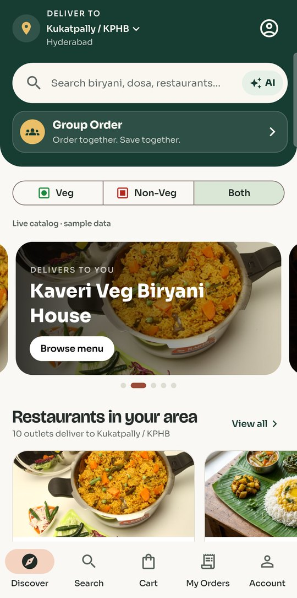 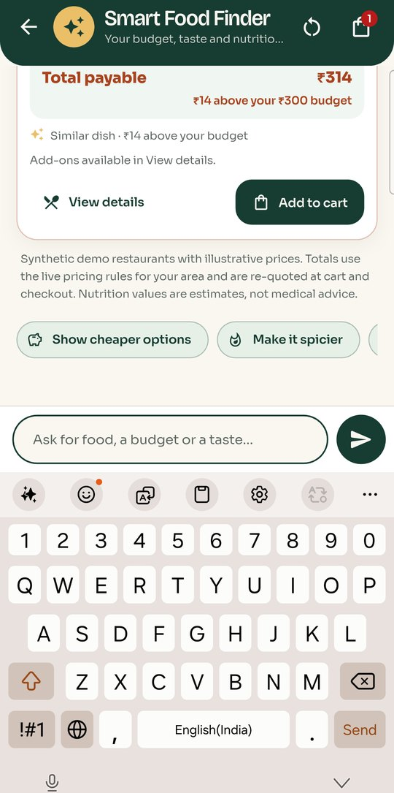   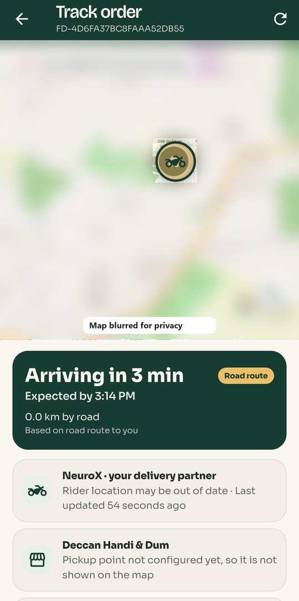

<a href="https://github.com/Accurate-Hackathon/KL-NeuroX/releases/download/v1.1.0/Samori.apk"></a>
<a href="https://github.com/Accurate-Hackathon/KL-NeuroX/releases/download/v1.1.0/Team-NeuroX_KL_University.mp4"></a>

**[Download Android APK](https://github.com/Accurate-Hackathon/KL-NeuroX/releases/download/v1.1.0/Samori.apk)** · **[Download Project Demonstration Video](https://github.com/Accurate-Hackathon/KL-NeuroX/releases/download/v1.1.0/Team-NeuroX_KL_University.mp4)** · [Release v1.1.0](https://github.com/Accurate-Hackathon/KL-NeuroX/releases/tag/v1.1.0)

**[For judges](#for-judges-install-and-try-it) · [Features](#implemented-features) · [Screenshots](#screenshots) · [Architecture](#architecture) · [Run it](#run-it-locally) · [Tests](#testing-evidence) · [Deployment](#deployment) · [Team](#team-neurox)**

</div>

---

## For judges: install and try it

1. On an Android phone (Android 7.0 or later), open **[Download Samori.apk](https://github.com/Accurate-Hackathon/KL-NeuroX/releases/download/v1.1.0/Samori.apk)**.
2. Open the downloaded file. If Android asks, allow **Install unknown apps** for your browser or Files app, then tap **Install**.
3. Open **SAMORI** and sign in with the demo accounts shared with the submission (one each for Customer, Restaurant Owner, Delivery Partner and Admin). Credentials are not published here.
4. The app connects to the hosted API on Render. The free server sleeps when idle, so the **first screen can take up to a minute** to load.
5. Payments run in **Razorpay Test Mode**: no real money moves. Use Razorpay's published test card or test UPI on the payment screen.

**Demonstration video:** [Team-NeuroX_KL_University.mp4](https://github.com/Accurate-Hackathon/KL-NeuroX/releases/download/v1.1.0/Team-NeuroX_KL_University.mp4) shows every feature end to end.

**Suggested 5-minute tour**
- **Customer:** set the delivery address to Gachibowli → try **Kids Meals** and the **AI Smart Food Finder** → order and pay in test mode → follow live tracking.
- **Restaurant Owner:** switch kitchen (shop icon) to the outlet you ordered from → accept, prepare, mark ready → manage Kids Meals (child icon).
- **Delivery Partner:** go online → accept the invitation → pick up → enter the customer's PIN → see **Earnings**.
- **Admin:** **Overview** dashboard (orders, revenue, platform and rider earnings) → record a rider payout.

---

## The problem

Ordering food for yourself, your family or a group of friends is still guesswork:

- **Hidden totals.** Menu prices hide delivery, packaging and platform fees, so "under ₹200" rarely means ₹200 at checkout.
- **Group friction.** Group orders mean one phone, many opinions and an awkward bill split.
- **No planning.** You can rarely book food for a specific time and trust it will arrive in that window.
- **Opaque tracking.** Customers can't see where their order actually is, or whether an ETA is real.

## What SAMORI does

SAMORI is one Flutter app with four roles. A NestJS + PostgreSQL backend is the single source of truth for prices, order state and authorization.

| Role | What they do |
|---|---|
| 🛒 **Customer** | Discover restaurants, AI Smart Food Finder, Kids Meals, cart and Razorpay test checkout, group orders with negotiation and bill split, scheduled delivery, live tracking, PIN handover |
| 🍳 **Restaurant Owner** | Accept or reject orders, kitchen workflow, scheduled orders, respond to group price requests, curate Kids Meals, switch between outlets |
| 🛵 **Delivery Partner** | Go online, accept invitations (first accept wins), pickup, live GPS sharing, PIN-verified delivery, Earnings and payouts |
| 🛡️ **Admin** | Overview dashboard with orders, revenue, platform and rider earnings, restaurant performance and transactions; record rider payouts; delivery dispatch |

| | Why it stands out |
|---|---|
| 🤖 **AI Smart Food Finder** | Ask in plain language ("veg meal with 25 g protein under ₹250"). Gemini only understands the request. Every recommendation is priced by the server on the **total payable**, including fees. |
| 🥗 **Nutrition everywhere** | Recipe-based calorie and protein estimates on ~90% of dishes, clearly marked as estimates. |
| 👥 **Group ordering + negotiation** | Order for friends on one phone, or invite them with a code. Ask the restaurant for a group price; it can accept, reject or counter. |
| 🧾 **Exact bill splitting** | Split by person (shared dishes divided once) or equally, in integer paise. Shares always add up to the amount paid. |
| 🗓️ **Scheduled delivery** | Book a ten-minute target window. The kitchen can't start early, and riders are invited at the right moment. |
| 🛵 **Live GPS tracking & smart ETA** | Real rider GPS during an active delivery, a road-route or clearly labelled estimated ETA, and honest "last updated" freshness. |
| 🔐 **Secure OTP handover** | Delivery completes only with the customer's 6-digit PIN (hashed, rate-limited, bound to the rider). |
| 🧒 **Kids Meals** | Smaller, mild dishes curated by restaurant owners, ordered through the normal cart and checkout. |
| 📊 **Finance visibility** | Admin revenue and earnings dashboard; rider earnings with a transparent 10% platform commission and recorded payouts. |
| 💳 **Razorpay Test Mode** | Real Razorpay checkout flow with test keys only; live keys are refused by the server. |

> **Catalog:** 38 synthetic restaurant outlets · 752 menu items (including 15 Kids Meals) · 10 Hyderabad localities. Prices and outlets are illustrative.

---

## Implemented features

| Area | What is implemented |
|---|---|
| AI Smart Food Finder | Natural-language requests; Gemini parses intent only; server prices every match on the total payable; calories and protein estimates where available |
| Group ordering | Order for friends by name or invite code, shared cart, restaurant price negotiation (accept / reject / counter), exact bill split by person or equally |
| Scheduled delivery | Ten-minute target windows from real hours, prep time and capacity; kitchen and rider dispatch follow the plan |
| Live tracking | Real rider GPS during an active delivery, honest freshness, road-route or labelled estimated ETA |
| Rider dispatch and handover | Automatic invitations, first accept wins, 6-digit PIN handover |
| Payments | Razorpay **Test Mode** for personal and group orders on the hosted build; payment verified server-side before the restaurant can accept |
| Admin dashboard | Customers, restaurants, riders; total / active / completed / cancelled orders; order revenue; platform earnings; rider earnings; pending and completed payouts; revenue trend; restaurant performance; recent orders and transactions; Today / Week / Month / All |
| Rider earnings | Today, week, month; gross; 10% platform commission (configurable); net payable; pending and paid payouts; per-delivery history |
| Rider payouts | Admin records manual settlements; never above the pending balance; idempotent. No bank transfer is made by the app |
| Kids Meals | Home button under Group Order, Kids Meals page by delivery area, owner on/off per dish, 15 seeded dishes across 6 outlets |
| Security | Four roles with RBAC, opaque hashed sessions, Argon2id passwords, rate limiting, integer-paise money, server-side pricing |
| Branding | Official SAMORI adaptive launcher icon and app name |

**How the finance numbers are calculated (real database records only):**
- *Order revenue* = total payable of orders that are not cancelled, rejected or still awaiting payment.
- *Rider gross earnings* = the delivery fee of each **completed** (PIN-verified) delivery; one assignment per order, so nothing is counted twice.
- *Platform commission* = 10% of rider gross earnings by default (`RIDER_COMMISSION_BPS`). Example: ₹1,000 gross → ₹100 commission → ₹900 net.
- *Platform earnings* = platform fees on orders + rider commission.
- *Pending payout* = net rider earnings − payouts recorded by the admin.
- *Kids Meals* show no invented nutrition or allergen data.

---

## Screenshots

All images are real screenshots of the running app on a Samsung S23 Ultra. Status bars are cropped; personal data, addresses, phone numbers and the map background are redacted or blurred. No OTP values are shown.

### 🛒 Customer

**Discovery and AI Smart Food Finder**

<table>
<tr>
<td align="center" width="25%"><br><sub>Home and discovery</sub></td>
<td align="center" width="25%">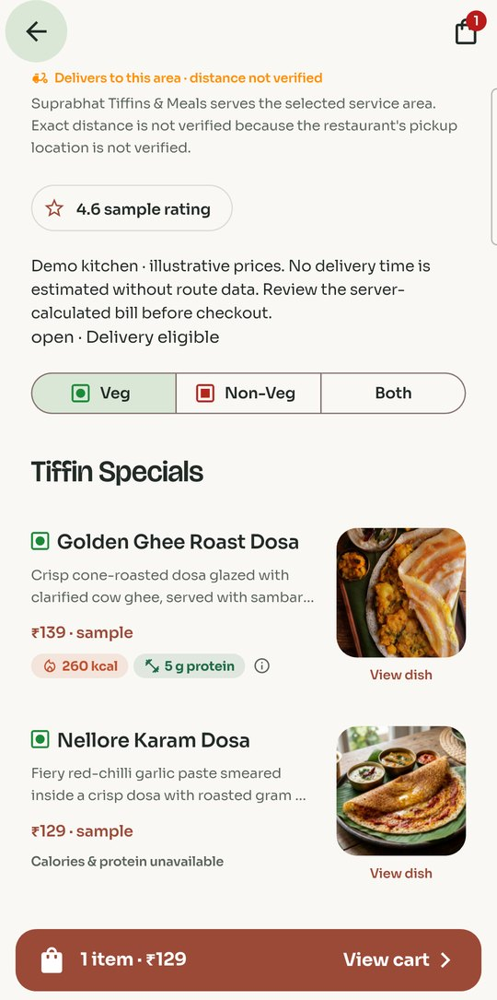<br><sub>Menu with calories and protein</sub></td>
<td align="center" width="25%">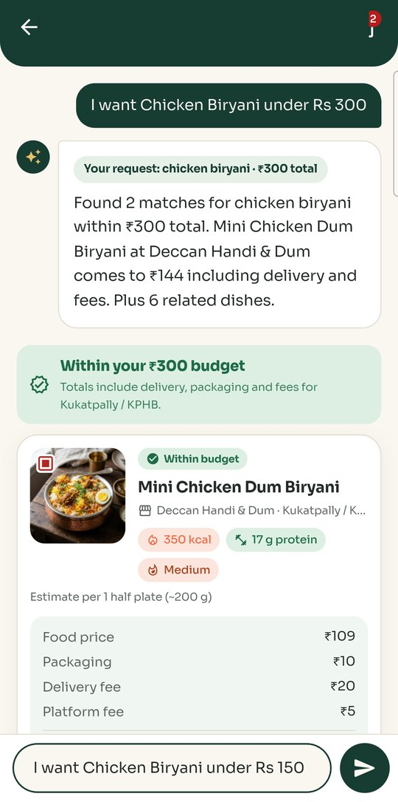<br><sub>Natural-language request</sub></td>
<td align="center" width="25%"><br><sub>Priced on total payable</sub></td>
</tr>
</table>

**Group ordering, negotiation and bill splitting**

<table>
<tr>
<td align="center" width="20%">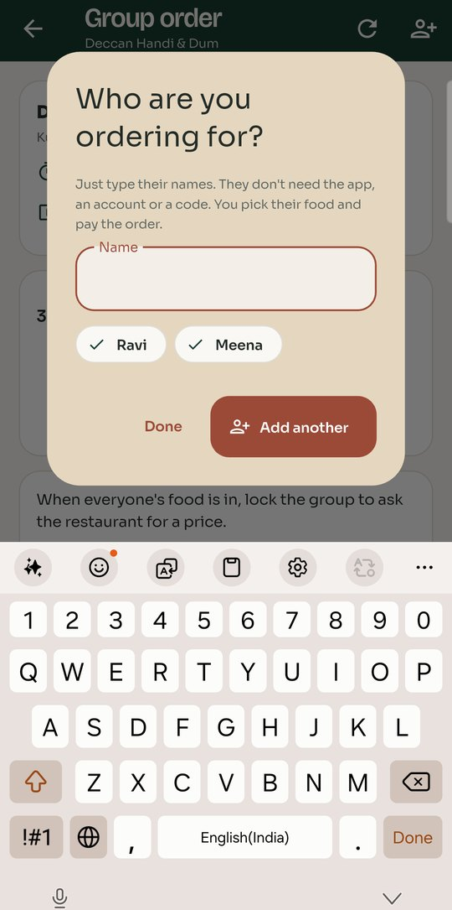<br><sub>Order for friends by name</sub></td>
<td align="center" width="20%"><br><sub>Shared group cart</sub></td>
<td align="center" width="20%"><br><sub>Restaurant counteroffer</sub></td>
<td align="center" width="20%"><br><sub>Split by person</sub></td>
<td align="center" width="20%"><br><sub>Split equally</sub></td>
</tr>
</table>

**Scheduled delivery, live tracking and secure handover**

<table>
<tr>
<td align="center" width="25%"><br><sub>Ten-minute target window</sub></td>
<td align="center" width="25%">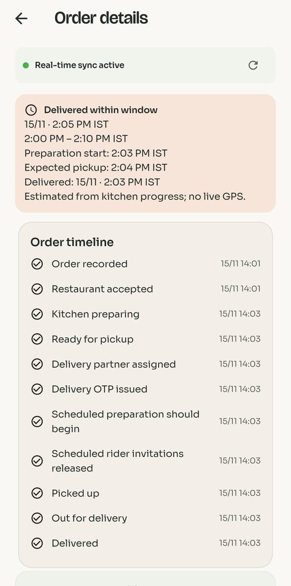<br><sub>Delivered within window</sub></td>
<td align="center" width="25%"><br><sub>Live rider map and ETA</sub></td>
<td align="center" width="25%">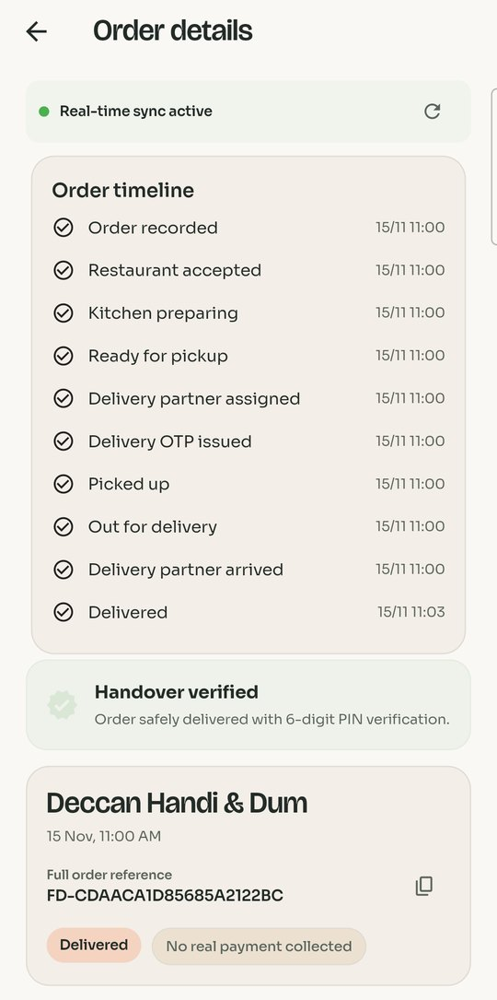<br><sub>OTP-verified delivery</sub></td>
</tr>
</table>

### 🍳 Restaurant owner

<table>
<tr>
<td align="center" width="33%">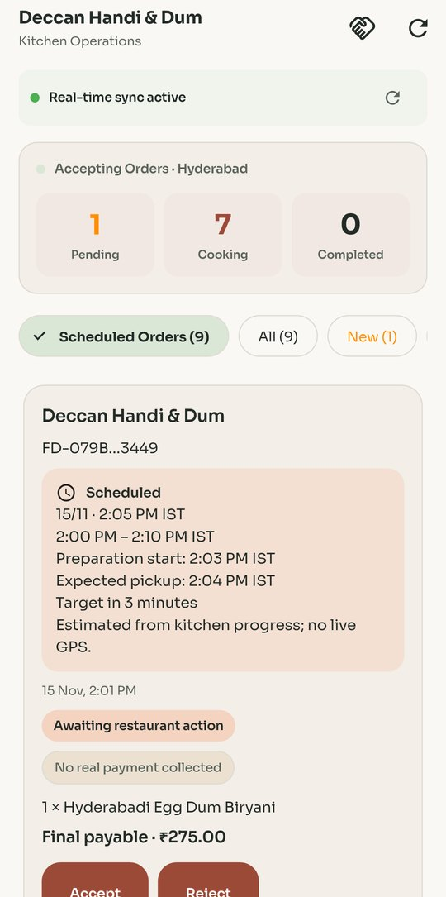<br><sub>Dashboard with scheduled orders</sub></td>
<td align="center" width="33%"><br><sub>Incoming order</sub></td>
<td align="center" width="33%">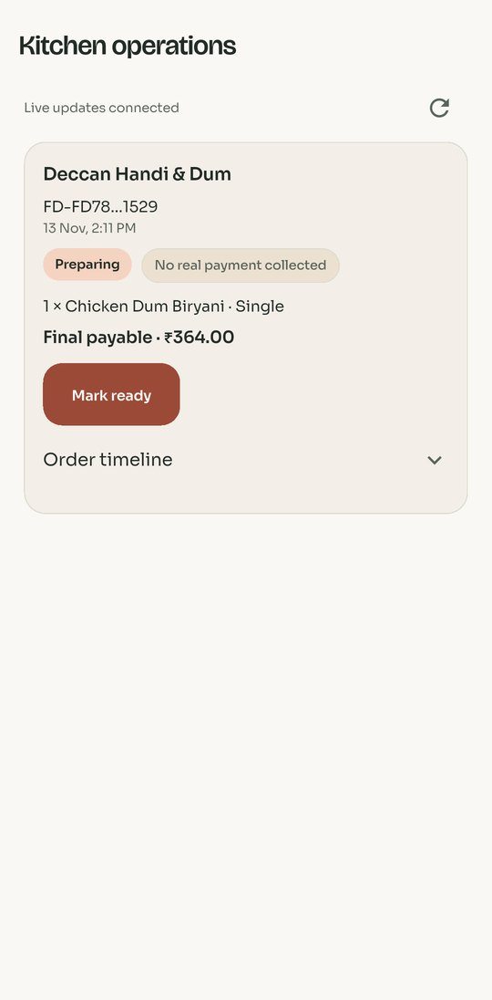<br><sub>Kitchen operations</sub></td>
</tr>
</table>

### 🛵 Delivery partner

<table>
<tr>
<td align="center" width="33%">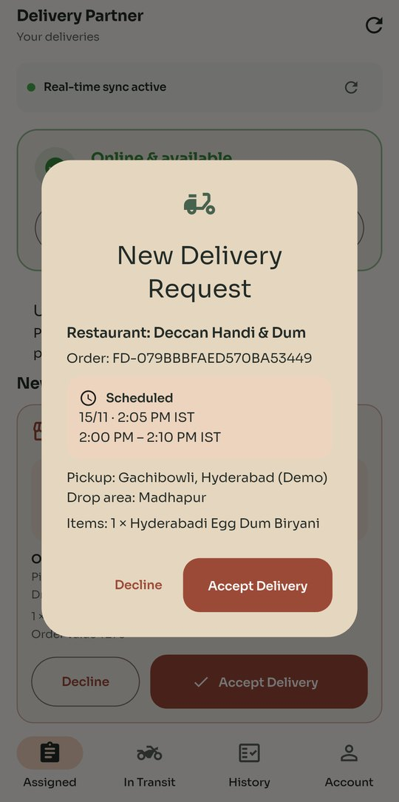<br><sub>Automatic invitation</sub></td>
<td align="center" width="33%"><br><sub>Active delivery (redacted)</sub></td>
<td align="center" width="33%"><br><sub>Out for delivery (redacted)</sub></td>
</tr>
</table>

### 🛡️ Administrator

<table>
<tr>
<td align="center" width="100%"><br><sub>Delivery dispatch view</sub></td>
</tr>
</table>

<details>
<summary><b>Feature collages</b></summary>

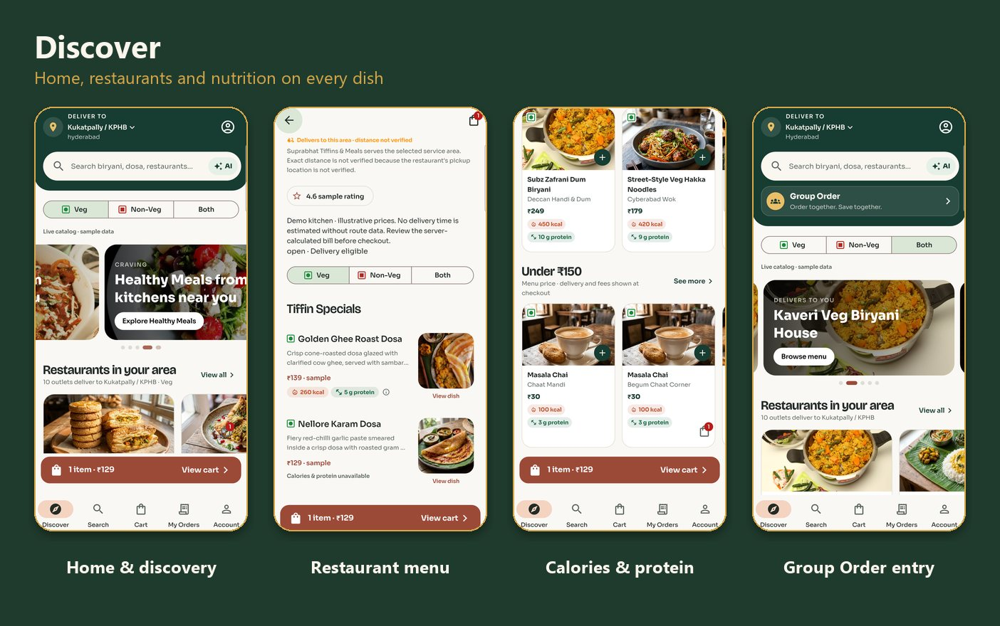
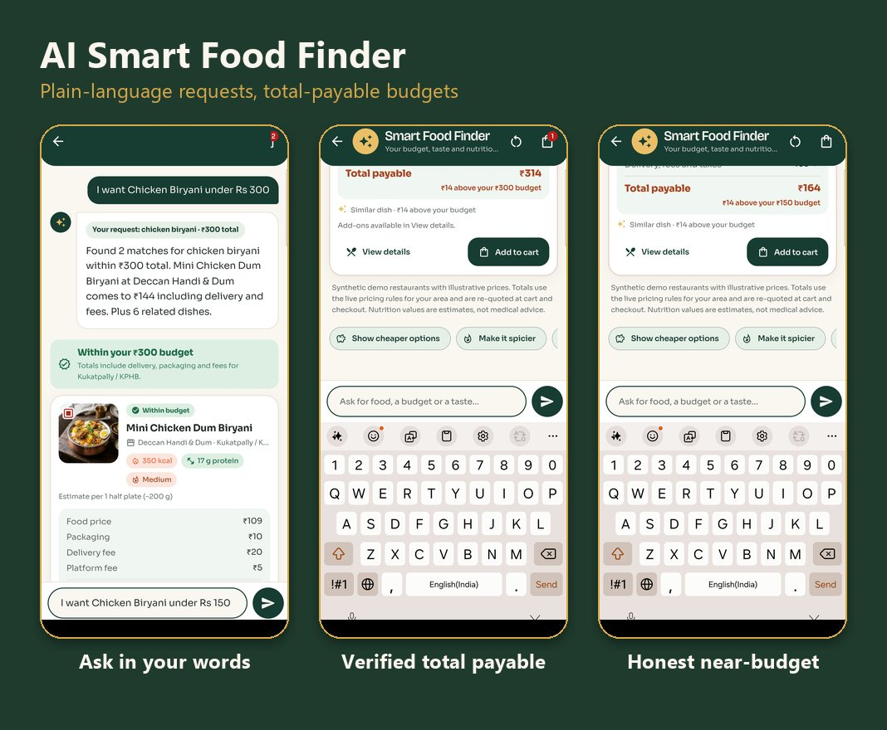


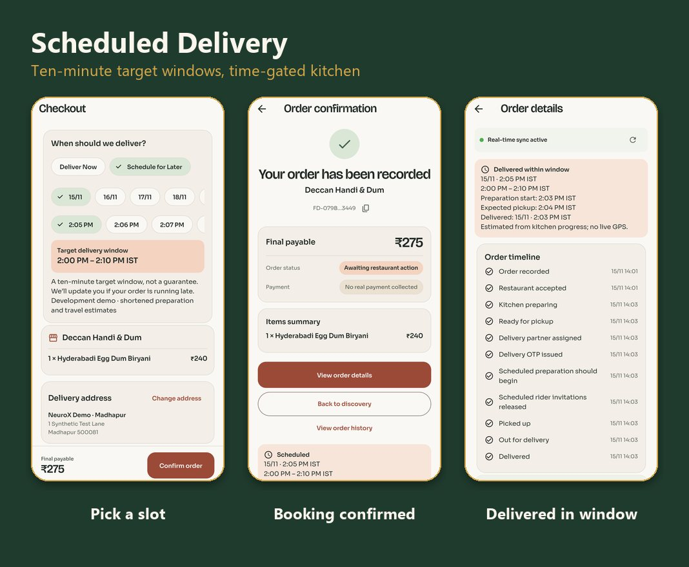

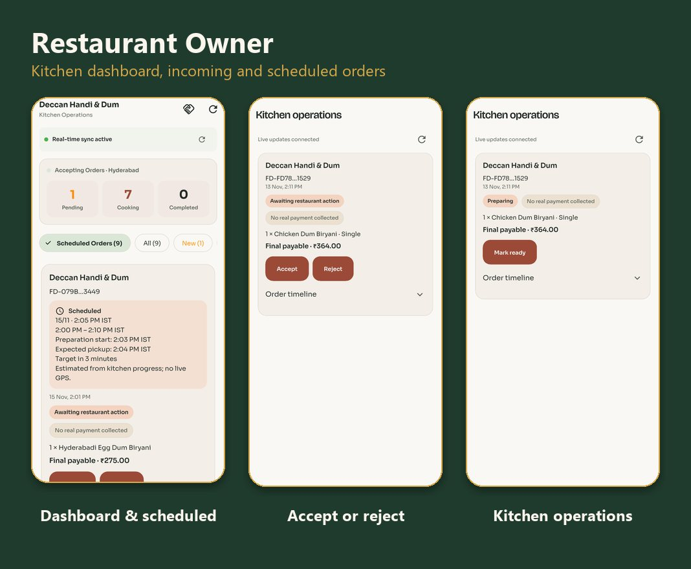
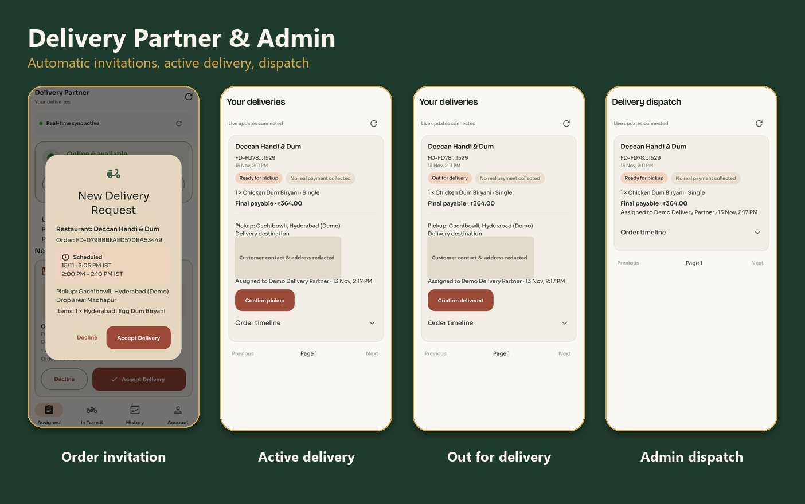
</details>

<sub>Screens added in the final release (admin Overview dashboard, rider Earnings, Kids Meals) are not shown above; see them in the app after installing the APK.</sub>

---

## Architecture

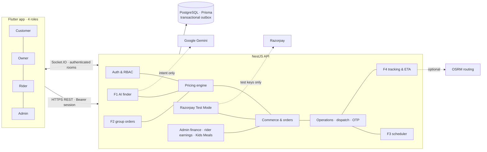

<details>
<summary><b>AI recommendation & total-payable budget</b></summary>

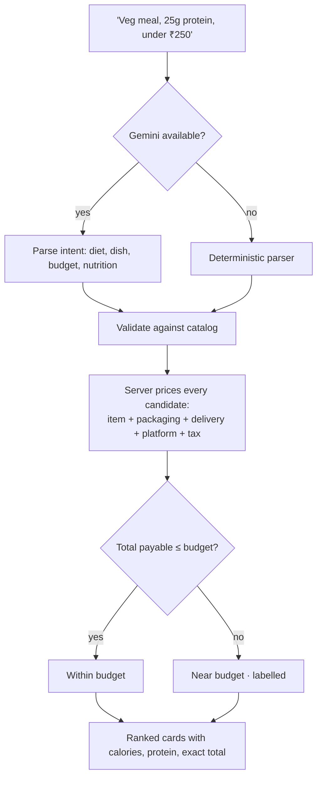
</details>

<details>
<summary><b>Group ordering & price negotiation</b></summary>

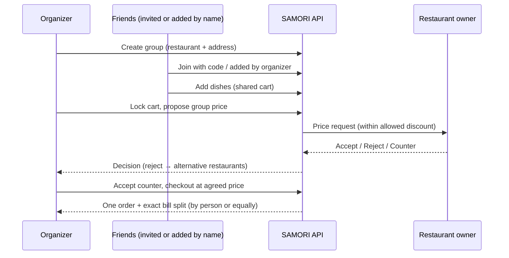
</details>

<details>
<summary><b>Order lifecycle: checkout to OTP delivery</b></summary>

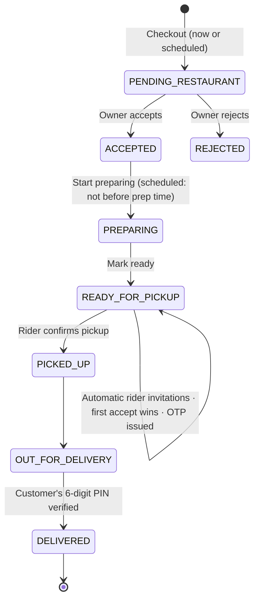
</details>

<details>
<summary><b>Live GPS tracking & Socket.IO</b></summary>

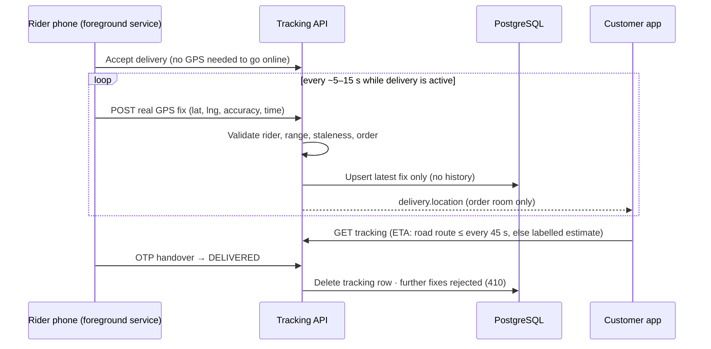
</details>

---

## Technology stack

| Layer | Technology |
|---|---|
| Mobile app | Flutter (Dart) · Riverpod · GoRouter · Dio · socket_io_client · flutter_map · geolocator · razorpay_flutter |
| Backend | NestJS 11 (TypeScript) · class-validator · Socket.IO |
| Database | PostgreSQL · Prisma ORM · 20 forward-only migrations · transactional outbox |
| AI | Google Gemini for intent parsing only, with a deterministic fallback |
| Routing | Optional OSRM-compatible provider; otherwise a clearly labelled estimate |
| Payments | Razorpay **Test Mode** only (live keys refused); no-payment demo checkout exists only in local development |
| Security | Opaque hashed sessions · RBAC · Argon2id · HMAC delivery PIN · rate limiting |
| Hosting | Render web service + Render PostgreSQL; signed Android release APK |

---

## Run it locally

**Prerequisites:**
- Node.js 20+ (tested on 22)
- PostgreSQL 15+ with the databases `food_delivery_dev` and `food_delivery_test`
- Flutter 3.x with the Android SDK

**1. Backend**

```powershell
cd backend
copy .env.example .env      # fill in local values; never commit .env
npm install
npm run db:generate
npm run db:migrate
npm run db:seed:hyd
npm run db:seed:auth
npm run build
npm start                   # http://localhost:5000/api/v1
```

**2. App on a USB-connected Android phone**

```powershell
adb reverse tcp:5000 tcp:5000
flutter pub get
flutter run --dart-define=API_BASE_URL=http://127.0.0.1:5000/api/v1/
```

**Demo accounts:** `customer@demo.test`, `restaurant@demo.test`, `rider@demo.test` and `admin@demo.test`. Their passwords are generated locally in `backend/.env`.

**Kids Meals sample dishes (optional):** `npx tsx scripts/seed-kids-meals.ts` from `backend` (create-only and safe to re-run).

**Optional local settings:**
- `SCHEDULE_DEMO_FAST=true` shortens scheduled-delivery timings for demos. It only works in development.
- `ROUTING_PROVIDER=osrm` turns on road-route ETAs. It is off by default.
- `RIDER_COMMISSION_BPS=1000` sets the platform commission on rider earnings (10%).
- Razorpay: set `RAZORPAY_KEY_ID` (must start with `rzp_test_`) and `RAZORPAY_KEY_SECRET`. On a production server also set `PAYMENTS_TEST_MODE_ENABLED=true`.

---

## Testing evidence

| Suite | Result |
|---|---|
| Backend unit | **29 / 29** |
| Backend end-to-end (real PostgreSQL, isolated test DB) | **127 / 127** |
| Flutter widget & unit tests | **162 / 162** |
| Flutter analyze | **clean** |

```powershell
cd backend; npm test; npm run test:e2e
cd ..; flutter analyze; flutter test
```

**On a Samsung S23 Ultra**
- **Scheduled delivery:** the order arrived within its window. Preparing early was refused. The rider invitation was released automatically.
- **Live tracking:**
  - Real phone GPS reached the server (about 11 m accuracy).
  - Updates kept flowing with the screen off.
  - The customer map showed LIVE.
  - Tracking stopped after OTP delivery.

Device evidence: [`docs/f3/`](docs/f3/IMPLEMENTATION.md) and [`docs/f4/device-result.json`](docs/f4/device-result.json).

**On the hosted API:** a complete order was placed, paid in Razorpay Test Mode from the Samsung, accepted, prepared, picked up and delivered with the customer's PIN. The admin dashboard and rider earnings reflect it.

---

## Deployment

| Component | Where |
|---|---|
| Backend API | Render web service: `https://samori-api.onrender.com/api/v1/` (health: `/api/v1/health`) |
| Database | Render PostgreSQL; migrations run automatically on each deploy |
| Android app | [Samori.apk](https://github.com/Accurate-Hackathon/KL-NeuroX/releases/download/v1.1.0/Samori.apk): signed release build pointing at the hosted API |
| Payments | Razorpay Test Mode (test keys set in the Render dashboard, never in the repository) |

The free Render instance sleeps when idle, so the first request after a pause can take up to a minute.
Configuration lives in [`render.yaml`](render.yaml) and the [production settings template](backend/.env.production.example); secrets are set only in the Render dashboard.

**Known limitations**
- Payments are Razorpay **Test Mode** only; no real money is collected and production payment processing is not enabled.
- Group bill-split shares are informational; the organizer pays the order total.
- A simultaneous two-phone moving-GPS run on the hosted API has not been recorded; live tracking was verified with real GPS on one Samsung.
- Catalog data, prices and nutrition estimates are illustrative.

---

## Future scope

- 🔁 Automatic rider replacement
- ✏️ Smart order modification after checkout
- 💳 Real split payments between group members (today's shares are informational)
- ♻️ Eco-friendly packaging partnerships
- 📈 Self-learning ETA from historical deliveries

---

## Documentation

- [Development handoff](docs/DEVELOPMENT_HANDOFF.md): modules, migrations, environment variables, workflows
- [F3 Scheduled delivery](docs/f3/IMPLEMENTATION.md) · [F4 Live tracking & ETA](docs/f4/IMPLEMENTATION.md)
- [Render blueprint](render.yaml) · [Azure deployment plan (alternative)](docs/DEPLOYMENT_PLAN.md)
- Earlier phases: [pricing](docs/phase3/IMPLEMENTATION_STATUS.md) · [authentication](docs/phase4/AUTHENTICATION.md) · [orders](docs/phase5/ORDER_FLOW.md) · [payments](docs/phase6/PAYMENT_FLOW.md) · [real-time](docs/phase7/REALTIME_ARCHITECTURE.md) · [secure handover](docs/phase7_1/SECURE_HANDOVER.md)
- [Asset credits](docs/ASSET_CREDITS.md)

---

## Repository

| | |
|---|---|
| Hackathon repository | [Accurate-Hackathon/KL-NeuroX](https://github.com/Accurate-Hackathon/KL-NeuroX) |
| Release | [Samori v1.1.0 · Hackathon Edition](https://github.com/Accurate-Hackathon/KL-NeuroX/releases/tag/v1.1.0) · [Download APK](https://github.com/Accurate-Hackathon/KL-NeuroX/releases/download/v1.1.0/Samori.apk) · [Demo video](https://github.com/Accurate-Hackathon/KL-NeuroX/releases/download/v1.1.0/Team-NeuroX_KL_University.mp4) |
| Default branch | `main` |
| Layout | `lib/` Flutter app · `backend/` NestJS API and Prisma schema · `docs/` design notes, evidence and screenshots |

---

## Team NeuroX

<p align="center"></p>

We thank the Accurate Background Hackathon 2026 organisers and mentors, and the open-source communities behind Flutter, NestJS, PostgreSQL, Prisma, Socket.IO and OpenStreetMap.

<div align="center"><sub><b>SAMORI</b> · Team NeuroX · Accurate Background Hackathon 2026</sub></div>
