<div align="center">


# SAMORI

### *Every choice, made with care.*

**A real-time, AI-assisted food delivery platform for Hyderabad**
Built by **Team NeuroX** for the **Accurate Background Hackathon 2026**


-46E3B7?logo=render&logoColor=white)

  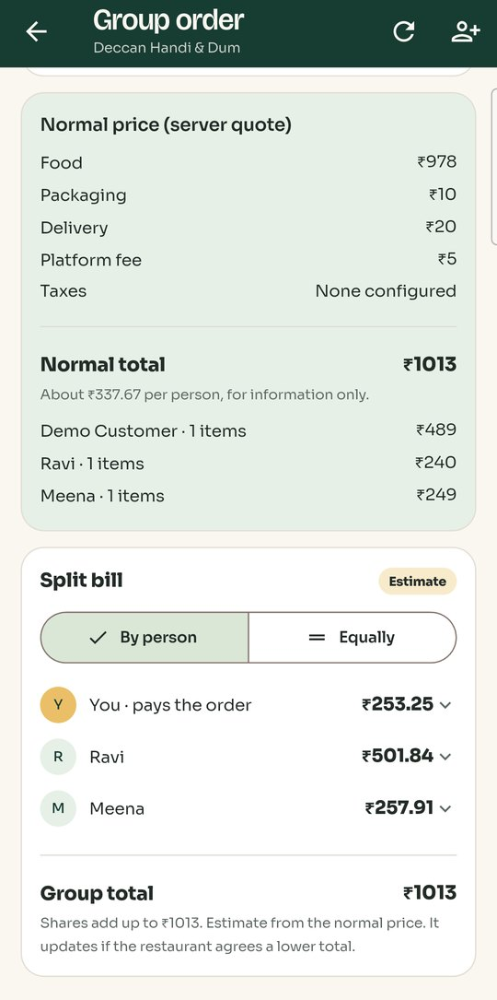 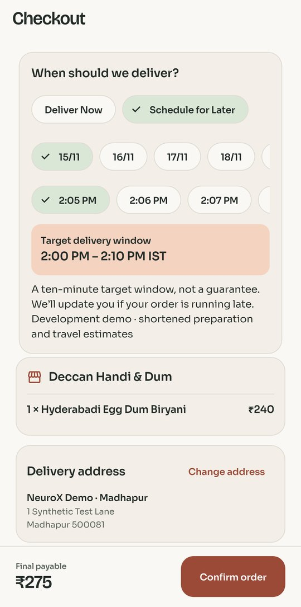 

**[Features](#what-samori-does) · [Screenshots](#screenshots) · [Architecture](#architecture) · [Run it](#run-it-locally) · [Tests](#testing-evidence) · [Deployment](#deployment-status) · [Team](#team-neurox)**

</div>

---

## The problem

Ordering food for yourself, your family or a group of friends is still guesswork:

- **Hidden totals.** Menu prices hide delivery, packaging and platform fees, so "under ₹200" rarely means ₹200 at checkout.
- **Group friction.** Group orders mean one phone, many opinions and an awkward bill split.
- **No planning.** You can rarely book food for a specific time and trust it will arrive in that window.
- **Opaque tracking.** Customers can't see where their order actually is, or whether an ETA is real.

## What SAMORI does

SAMORI is one Flutter app with four roles: **Customer**, **Restaurant Owner**, **Delivery Partner** and **Admin**. A NestJS + PostgreSQL backend is the single source of truth for prices, order state and authorization.

| | Why it stands out |
|---|---|
| 🤖 **AI Smart Food Finder** | Ask in plain language ("veg meal with 25 g protein under ₹250"). Gemini only understands the request. Every recommendation is priced by the server on the **total payable**, including fees. |
| 🥗 **Nutrition everywhere** | Recipe-based calorie and protein estimates on ~90% of dishes, clearly marked as estimates. |
| 👥 **Group ordering + negotiation** | Order for friends on one phone, or invite them with a code. Ask the restaurant for a group price; it can accept, reject or counter. |
| 🧾 **Exact bill splitting** | Split by person (shared dishes divided once) or equally, in integer paise. Shares always add up to the amount paid. |
| 🗓️ **Scheduled delivery** | Book a ten-minute target window. The kitchen can't start early, and riders are invited at the right moment. |
| 🛵 **Live GPS tracking & smart ETA** | Real rider GPS during an active delivery, a road-route or clearly labelled estimated ETA, and honest "last updated" freshness. |
| 🔐 **Secure OTP handover** | Delivery completes only with the customer's 6-digit PIN (hashed, rate-limited, bound to the rider). |

> **Development catalog:** 38 synthetic restaurant outlets · 737 menu items · 10 Hyderabad localities. Prices and outlets are illustrative.

---

## Feature status

| ID | Feature | Status |
|---|---|---|
| F1 | AI Smart Food Finder, total-payable budget filtering, calories & protein | ✅ Merged |
| F2 | Group ordering, Order for Friends, restaurant price negotiation, bill splitting | ✅ Merged |
| F3 | Scheduled delivery with time-gated kitchen and automatic rider dispatch | ✅ Merged |
| F4 | Real-time rider GPS tracking and dynamic ETA | ✅ Merged |
| F7 | Automatic rider invitations (first accept wins) and secure OTP handover | ✅ Merged |
| — | Four-role authentication (opaque sessions, RBAC) | ✅ Merged |
| v1.1 | Razorpay TEST checkout on the hosted build (personal and group orders) | ✅ Merged, verified on Render |
| v1.1 | Admin dashboard: people, orders, revenue, platform earnings, restaurant performance, transactions, Today/Week/Month/All filters | ✅ Merged |
| v1.1 | Delivery partner Earnings: today/week/month, gross, 10% platform commission, net payable, payouts, per-delivery history | ✅ Merged |
| v1.1 | Manual rider payout settlements recorded by the admin (no bank transfer) | ✅ Merged |
| v1.1 | Kids Meals: home button, Kids Meals page, owner-curated dishes, normal cart and Razorpay checkout | ✅ Merged |
| v1.1 | Official SAMORI launcher icon (adaptive, themed) and app name; light-mode readability fix for header sheets | ✅ Merged |

**How the v1.1 numbers are calculated (real database records only):**
- *Order revenue* = total payable of orders that are not cancelled, rejected or still awaiting payment.
- *Rider gross earnings* = the delivery fee of each **completed** (OTP-verified) delivery; one assignment per order, so nothing is counted twice.
- *Platform commission* = `RIDER_COMMISSION_BPS` of rider gross earnings (default 1000 = 10%). Example: ₹1,000 gross → ₹100 commission → ₹900 net.
- *Platform earnings* = platform fees on orders + rider commission.
- *Pending payout* = net rider earnings − payouts recorded by the admin. A payout can never exceed the pending balance and is idempotent.
- *Kids Meals* are dishes the restaurant owner marks as suitable for children. No nutrition or allergen data is invented; estimates show only where they already exist.

---

## Screenshots

All images are real screenshots of the running app on a Samsung S23 Ultra. Status bars are cropped; personal data, addresses, phone numbers and the map background are redacted or blurred. No OTP values are shown.

### 🛒 Customer

**Discovery and AI Smart Food Finder**

<table>
<tr>
<td align="center" width="25%"><br><sub>Home and discovery</sub></td>
<td align="center" width="25%"><br><sub>Menu with calories and protein</sub></td>
<td align="center" width="25%"><br><sub>Natural-language request</sub></td>
<td align="center" width="25%"><br><sub>Priced on total payable</sub></td>
</tr>
</table>

**Group ordering, negotiation and bill splitting**

<table>
<tr>
<td align="center" width="20%"><br><sub>Order for friends by name</sub></td>
<td align="center" width="20%">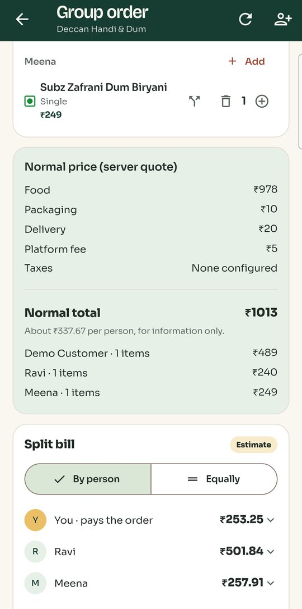<br><sub>Shared group cart</sub></td>
<td align="center" width="20%">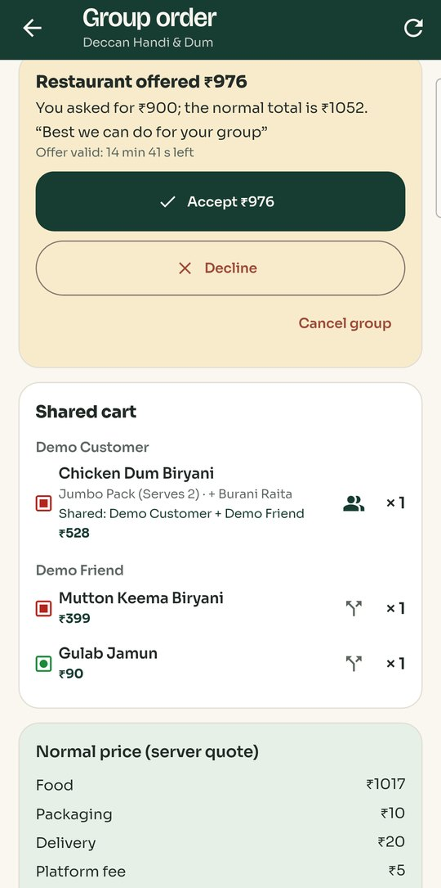<br><sub>Restaurant counteroffer</sub></td>
<td align="center" width="20%"><br><sub>Split by person</sub></td>
<td align="center" width="20%">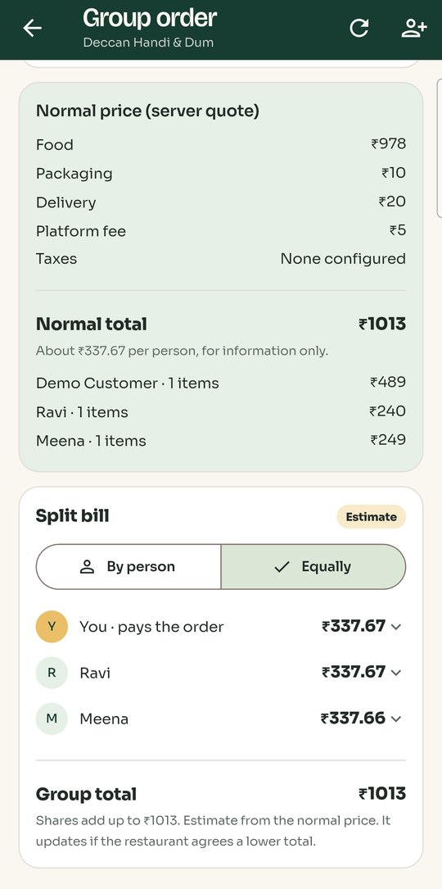<br><sub>Split equally</sub></td>
</tr>
</table>

**Scheduled delivery, live tracking and secure handover**

<table>
<tr>
<td align="center" width="25%"><br><sub>Ten-minute target window</sub></td>
<td align="center" width="25%"><br><sub>Delivered within window</sub></td>
<td align="center" width="25%"><br><sub>Live rider map and ETA</sub></td>
<td align="center" width="25%"><br><sub>OTP-verified delivery</sub></td>
</tr>
</table>

### 🍳 Restaurant owner

<table>
<tr>
<td align="center" width="33%"><br><sub>Dashboard with scheduled orders</sub></td>
<td align="center" width="33%">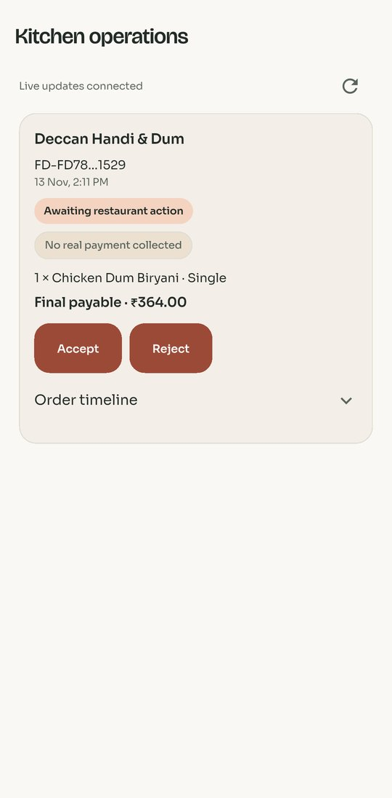<br><sub>Incoming order</sub></td>
<td align="center" width="33%"><br><sub>Kitchen operations</sub></td>
</tr>
</table>

### 🛵 Delivery partner

<table>
<tr>
<td align="center" width="33%"><br><sub>Automatic invitation</sub></td>
<td align="center" width="33%">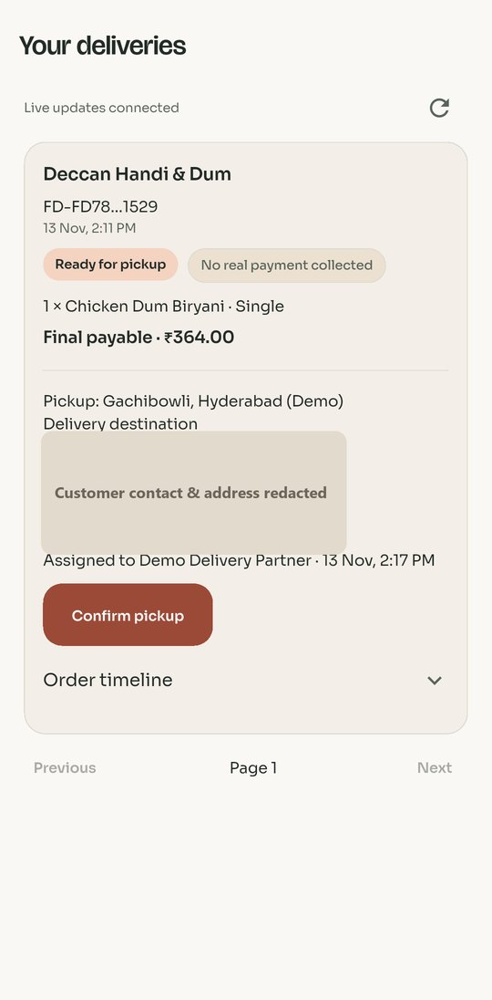<br><sub>Active delivery (redacted)</sub></td>
<td align="center" width="33%">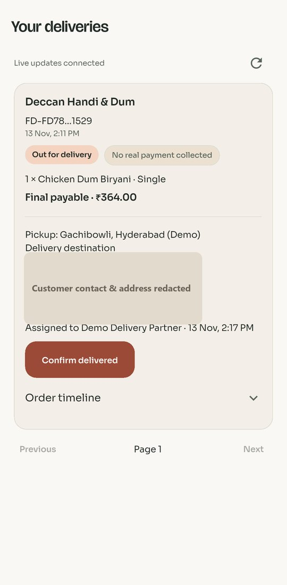<br><sub>Out for delivery (redacted)</sub></td>
</tr>
</table>

### 🛡️ Administrator

<table>
<tr>
<td align="center" width="100%">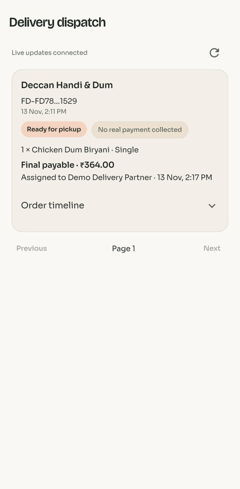<br><sub>Delivery dispatch view</sub></td>
</tr>
</table>

<details>
<summary><b>Feature collages</b></summary>


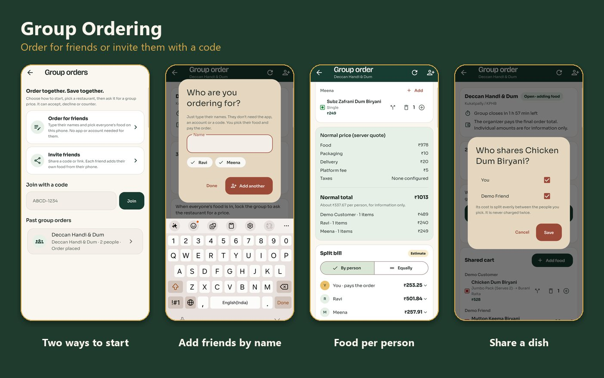
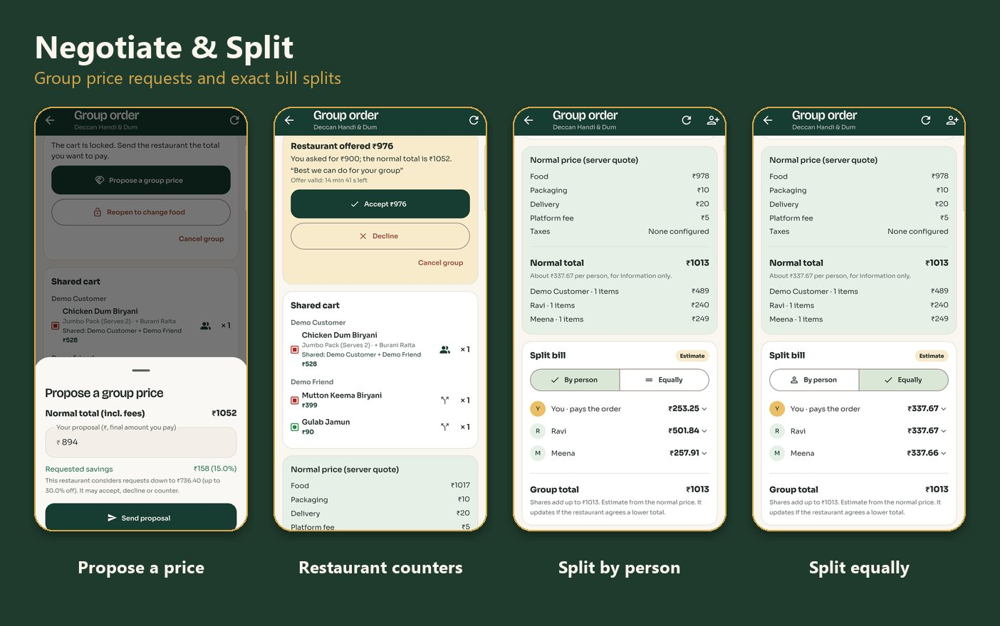


</details>

<sub>Not yet photographed, though the features exist and are covered by automated tests: the owner's Group Proposals screen, the rider's Online toggle, the rider's live-location panel and PIN entry, and other admin views.</sub>

---

## Architecture

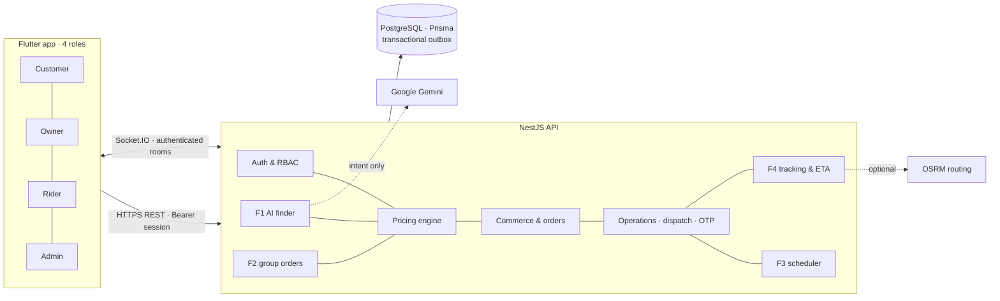

<details>
<summary><b>AI recommendation & total-payable budget</b></summary>

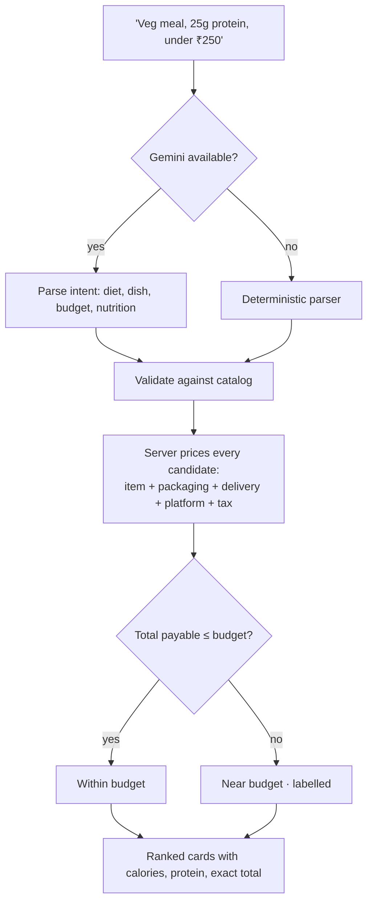
</details>

<details>
<summary><b>Group ordering & price negotiation</b></summary>

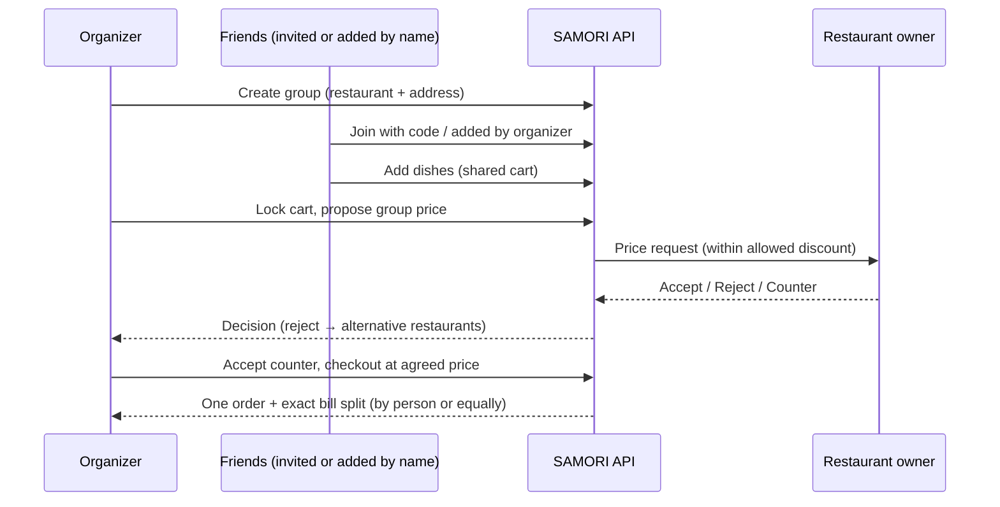
</details>

<details>
<summary><b>Order lifecycle: checkout to OTP delivery</b></summary>

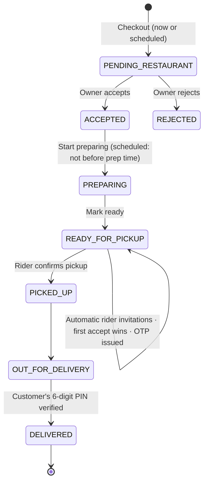
</details>

<details>
<summary><b>Live GPS tracking & Socket.IO</b></summary>

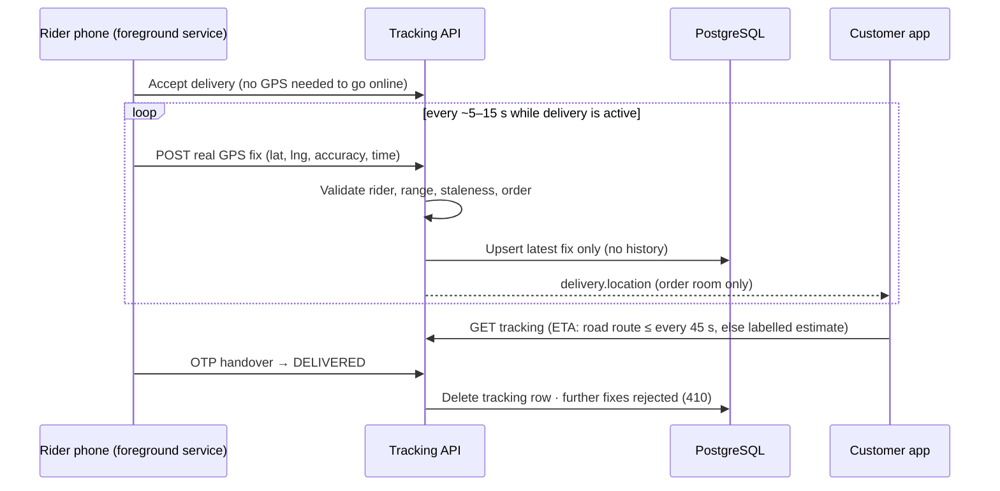
</details>

---

## Technology stack

| Layer | Technology |
|---|---|
| Mobile app | Flutter (Dart) · Riverpod · GoRouter · Dio · socket_io_client · flutter_map · geolocator · razorpay_flutter |
| Backend | NestJS 11 (TypeScript) · class-validator · Socket.IO |
| Database | PostgreSQL · Prisma ORM · 19 forward-only migrations · transactional outbox |
| AI | Google Gemini for intent parsing only, with a deterministic fallback |
| Routing | Optional OSRM-compatible provider; otherwise a clearly labelled estimate |
| Payments | Razorpay **test** mode; demo no-payment checkout in development |
| Security | Opaque hashed sessions · RBAC · Argon2id · HMAC delivery PIN · rate limiting |
| Hosting | Render web service + Render PostgreSQL (staging) |

---

## Run it locally

**Prerequisites:**
- Node.js 20+ (tested on 22)
- PostgreSQL 15+ with the databases `food_delivery_dev` and `food_delivery_test`
- Flutter 3.x with the Android SDK

**1. Backend**

```powershell
cd backend
copy .env.example .env      # fill in local values; never commit .env
npm install
npm run db:generate
npm run db:migrate
npm run db:seed:hyd
npm run db:seed:auth
npm run build
npm start                   # http://localhost:5000/api/v1
```

**2. App on a USB-connected Android phone**

```powershell
adb reverse tcp:5000 tcp:5000
flutter pub get
flutter run --dart-define=API_BASE_URL=http://127.0.0.1:5000/api/v1/
```

**Demo accounts:** `customer@demo.test`, `restaurant@demo.test`, `rider@demo.test` and `admin@demo.test`. Their passwords are generated locally in `backend/.env`.

**Optional local settings:**
- `SCHEDULE_DEMO_FAST=true` shortens scheduled-delivery timings for demos. It only works in development.
- `ROUTING_PROVIDER=osrm` turns on road-route ETAs. It is off by default.

---

## Testing evidence

| Suite | Result |
|---|---|
| Backend unit | **29 / 29** |
| Backend end-to-end (real PostgreSQL, isolated test DB) | **127 / 127** |
| Flutter widget & unit tests | **162 / 162** |
| Flutter analyze | **clean** |

```powershell
cd backend; npm test; npm run test:e2e
cd ..; flutter analyze; flutter test
```

**On a Samsung S23 Ultra**
- **Scheduled delivery:** the order arrived within its window. Preparing early was refused. The rider invitation was released automatically.
- **Live tracking:**
  - Real phone GPS reached the server (about 11 m accuracy).
  - Updates kept flowing with the screen off.
  - The customer map showed LIVE.
  - Tracking stopped after OTP delivery.

Device evidence: [`docs/f3/`](docs/f3/IMPLEMENTATION.md) and [`docs/f4/device-result.json`](docs/f4/device-result.json).

> **Still to verify:**
> - Simultaneous two-phone GPS movement (rider and customer on separate phones) on the hosted API.
> - Hosted checkout on Render (Razorpay test mode).
> - Production-scale payment processing is **not** verified. Checkout uses a demo mode or Razorpay **test** mode.

---

## Deployment status

**Backend: live on Render as a staging environment.**

| Item | Status |
|---|---|
| API web service (`https://samori-api.onrender.com/api/v1/`) | ✅ Live. Health check reports API and database up |
| Render PostgreSQL | ✅ Migrations applied automatically on deploy (20 with v1.1) |
| Catalog | ✅ Seeded: 38 outlets, 737 menu items, 10 localities |
| Four roles | ✅ Non-demo accounts for customer, owner, rider and admin sign in |
| Address, cart and price quote over the live API | ✅ Verified |
| Hosted checkout | ✅ Razorpay TEST payment completed from the Samsung on the hosted API (order marked PAID). Demo checkout stays refused in production |
| Two-phone moving-GPS test on the hosted API | ⏳ Pending |
| Release APK pointing at the hosted API | ✅ Samori-v1.1 (signed, hosted API); v1.0.1 installed and used on the Samsung |

The free Render instance sleeps when idle, so the first request after a pause can take up to a minute.
Configuration lives in [`render.yaml`](render.yaml) and the [production settings template](backend/.env.production.example); secrets are set only in the Render dashboard. An [Azure deployment plan](docs/DEPLOYMENT_PLAN.md) is kept as a documented alternative.

---

## Future scope (not implemented)

- 🔁 Automatic rider replacement
- ✏️ Smart order modification after checkout
- 💳 Real split payments between group members (today's shares are informational)
- ♻️ Eco-friendly packaging partnerships
- 📈 Self-learning ETA from historical deliveries

---

## Documentation

- [Development handoff](docs/DEVELOPMENT_HANDOFF.md): modules, migrations, environment variables, workflows
- [F3 Scheduled delivery](docs/f3/IMPLEMENTATION.md) · [F4 Live tracking & ETA](docs/f4/IMPLEMENTATION.md)
- [Render blueprint](render.yaml) · [Deployment plan (Azure alternative)](docs/DEPLOYMENT_PLAN.md)
- Earlier phases: [pricing](docs/phase3/IMPLEMENTATION_STATUS.md) · [authentication](docs/phase4/AUTHENTICATION.md) · [orders](docs/phase5/ORDER_FLOW.md) · [payments](docs/phase6/PAYMENT_FLOW.md) · [real-time](docs/phase7/REALTIME_ARCHITECTURE.md) · [secure handover](docs/phase7_1/SECURE_HANDOVER.md)
- [Asset credits](docs/ASSET_CREDITS.md)

---

## Repository

| | |
|---|---|
| Personal repository | [Raghuram1784/smart_food_app](https://github.com/Raghuram1784/smart_food_app) |
| Hackathon repository | [Accurate-Hackathon/KL-NeuroX](https://github.com/Accurate-Hackathon/KL-NeuroX) |
| Default branch | `main` (kept identical in both repositories) |
| Layout | `lib/` Flutter app · `backend/` NestJS API and Prisma schema · `docs/` design notes, evidence and screenshots |

---

## Team NeuroX

<p align="center">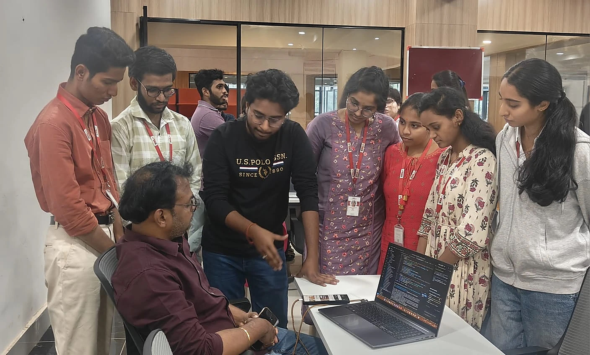</p>

We thank the Accurate Background Hackathon 2026 organisers and mentors, and the open-source communities behind Flutter, NestJS, PostgreSQL, Prisma, Socket.IO and OpenStreetMap.

<div align="center"><sub><b>SAMORI</b> · Team NeuroX · Accurate Background Hackathon 2026</sub></div>
