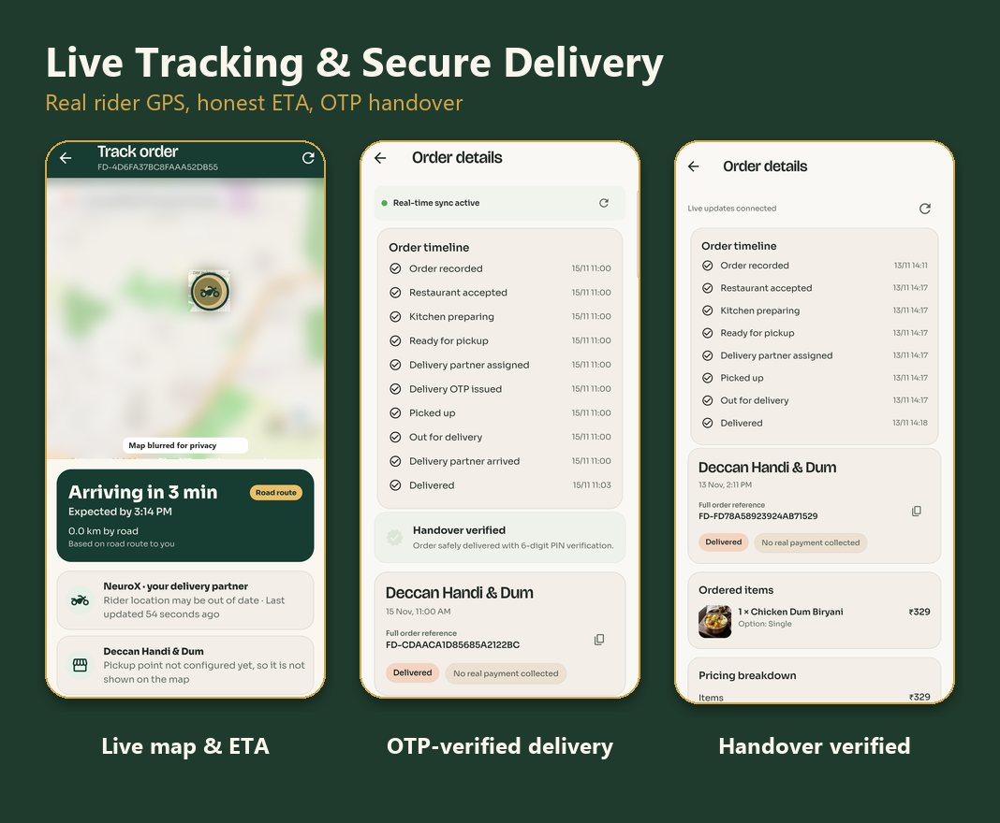
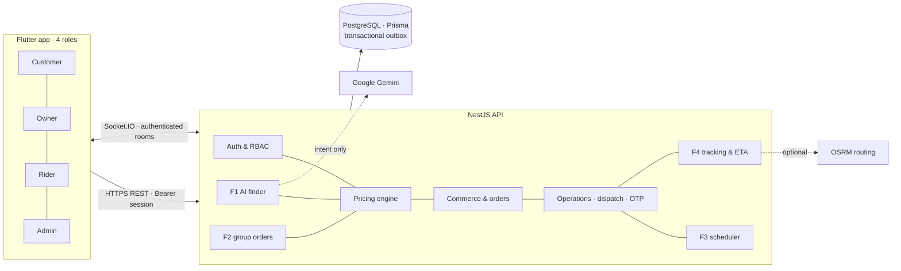
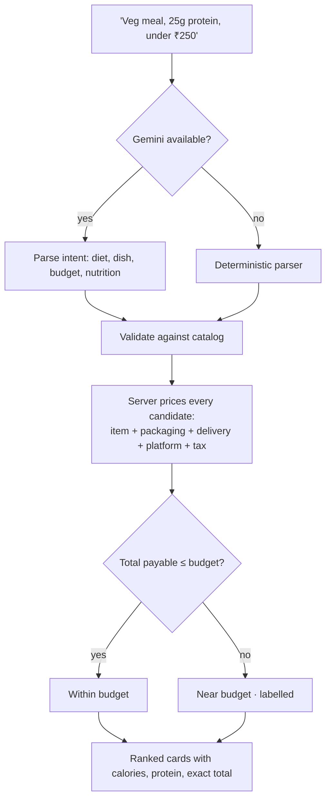
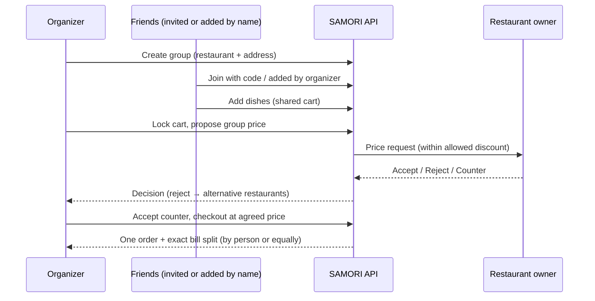
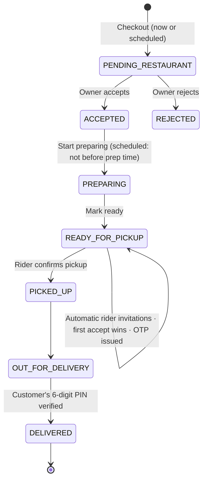
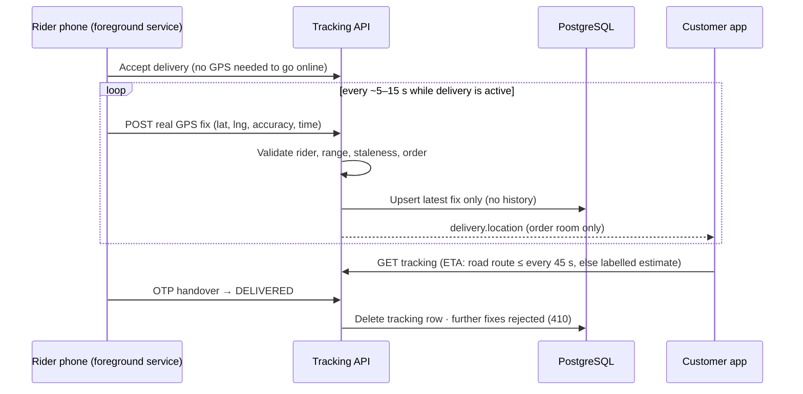

<div align="center">

# 🍃 SAMORI

### *Every choice, made with care.*

**A real-time, AI-assisted food delivery platform for Hyderabad**
Built by **Team NeuroX** for the **Accurate AI Hackathon**


</div>

---

## The problem

Ordering food for yourself, your family or a group of friends is still guesswork:

- **Hidden totals.** Menu prices hide delivery, packaging and platform fees, so "under ₹200" rarely means ₹200 at checkout.
- **Group friction.** Group orders mean one phone, many opinions and an awkward bill split.
- **No planning.** You can rarely book food for a specific time and trust it will arrive in that window.
- **Opaque tracking.** Customers can't see where their order actually is, or whether an ETA is real.

## What SAMORI does

SAMORI is one Flutter app with four roles: **Customer**, **Restaurant Owner**, **Delivery Partner** and **Admin**. A NestJS + PostgreSQL backend is the single source of truth for prices, order state and authorization.

| | Why it stands out |
|---|---|
| 🤖 **AI Smart Food Finder** | Ask in plain language ("veg meal with 25 g protein under ₹250"). Gemini only understands the request. Every recommendation is priced by the server on the **total payable**, including fees. |
| 🥗 **Nutrition everywhere** | Recipe-based calorie and protein estimates on ~90% of dishes, clearly marked as estimates. |
| 👥 **Group ordering + negotiation** | Order for friends on one phone, or invite them with a code. Ask the restaurant for a group price; it can accept, reject or counter. |
| 🧾 **Exact bill splitting** | Split by person (shared dishes divided once) or equally, in integer paise. Shares always add up to the amount paid. |
| 🗓️ **Scheduled delivery** | Book a ten-minute target window. The kitchen can't start early, and riders are invited at the right moment. |
| 🛵 **Live GPS tracking & smart ETA** | Real rider GPS during an active delivery, a road-route or clearly labelled estimated ETA, and honest "last updated" freshness. |
| 🔐 **Secure OTP handover** | Delivery completes only with the customer's 6-digit PIN (hashed, rate-limited, bound to the rider). |

> **Development catalog:** 38 synthetic restaurant outlets · 737 menu items · 10 Hyderabad localities. Prices and outlets are illustrative.

---

## Feature status

| ID | Feature | Status |
|---|---|---|
| F1 | AI Smart Food Finder, total-payable budget filtering, calories & protein | ✅ Merged |
| F2 | Group ordering, Order for Friends, restaurant price negotiation, bill splitting | ✅ Merged |
| F3 | Scheduled delivery with time-gated kitchen and automatic rider dispatch | ✅ Merged |
| F4 | Real-time rider GPS tracking and dynamic ETA | ✅ Merged |
| F7 | Automatic rider invitations (first accept wins) and secure OTP handover | ✅ Merged |
| — | Four-role authentication (opaque sessions, RBAC) | ✅ Merged |

---

## Screenshots

All images are real screenshots of the running app, mostly from a Samsung S23 Ultra. Personal data, addresses, phone numbers and map locations are redacted.

### Customer




### Restaurant owner


### Delivery partner & admin


<sub>Some screens haven't been photographed yet, though the features exist and are covered by automated tests: the owner's Group Proposals screen, the rider's Online toggle, the rider's live-location panel and PIN entry, and other admin views.</sub>

---

## Architecture



<details>
<summary><b>AI recommendation & total-payable budget</b></summary>


</details>

<details>
<summary><b>Group ordering & price negotiation</b></summary>


</details>

<details>
<summary><b>Order lifecycle: checkout to OTP delivery</b></summary>


</details>

<details>
<summary><b>Live GPS tracking & Socket.IO</b></summary>


</details>

---

## Run it locally

**Prerequisites:**
- Node.js 20+ (tested on 22)
- PostgreSQL 15+ with the databases `food_delivery_dev` and `food_delivery_test`
- Flutter 3.x with the Android SDK

**1. Backend**

```powershell
cd backend
copy .env.example .env      # fill in local values; never commit .env
npm install
npm run db:generate
npm run db:migrate
npm run db:seed:hyd
npm run db:seed:auth
npm run build
npm start                   # http://localhost:5000/api/v1
```

**2. App on a USB-connected Android phone**

```powershell
adb reverse tcp:5000 tcp:5000
flutter pub get
flutter run --dart-define=API_BASE_URL=http://127.0.0.1:5000/api/v1/
```

**Demo accounts:** `customer@demo.test`, `restaurant@demo.test`, `rider@demo.test` and `admin@demo.test`. Their passwords are generated locally in `backend/.env`.

**Optional local settings:**
- `SCHEDULE_DEMO_FAST=true` shortens scheduled-delivery timings for demos. It only works in development.
- `ROUTING_PROVIDER=osrm` turns on road-route ETAs. It is off by default.

---

## Testing evidence

| Suite | Result |
|---|---|
| Backend unit | **27 / 27** |
| Backend end-to-end (real PostgreSQL, isolated test DB) | **126 / 126** |
| Flutter widget & unit tests | **162 / 162** |
| Flutter analyze | **clean** |

```powershell
cd backend; npm test; npm run test:e2e
cd ..; flutter analyze; flutter test
```

**On a Samsung S23 Ultra**
- **Scheduled delivery:** the order arrived within its window. Preparing early was refused. The rider invitation was released automatically.
- **Live tracking:**
  - Real phone GPS reached the server (about 11 m accuracy).
  - Updates kept flowing with the screen off.
  - The customer map showed LIVE.
  - Tracking stopped after OTP delivery.

Device evidence: [`docs/f3/`](docs/f3/IMPLEMENTATION.md) and [`docs/f4/device-result.json`](docs/f4/device-result.json).

> **Still to verify:**
> - Simultaneous two-phone GPS movement (rider and customer on separate phones) will be tested after deployment.
> - Production-scale payment processing is **not** verified. Checkout uses a demo mode or Razorpay **test** mode.

---

## Deployment status

**Selected platform: Microsoft Azure.**
- Azure App Service for the NestJS API (WebSockets, Always On).
- Azure Database for PostgreSQL – Flexible Server.
- A Flutter release APK.

**Not deployed yet. There is no live URL.** See the [deployment plan](docs/DEPLOYMENT_PLAN.md) and the [production settings template](backend/.env.production.example). A Render blueprint is kept only as a [non-selected alternative](deploy/README.md).

---

## Future scope (not implemented)

- 🧒 Kids Meals
- 🔁 Automatic rider replacement
- ✏️ Smart order modification after checkout
- 💳 Real split payments between group members (today's shares are informational)
- ♻️ Eco-friendly packaging partnerships
- 📈 Self-learning ETA from historical deliveries

---

## Documentation

- [Development handoff](docs/DEVELOPMENT_HANDOFF.md): modules, migrations, environment variables, workflows
- [F3 Scheduled delivery](docs/f3/IMPLEMENTATION.md) · [F4 Live tracking & ETA](docs/f4/IMPLEMENTATION.md)
- [Deployment plan (Azure)](docs/DEPLOYMENT_PLAN.md)
- Earlier phases: [pricing](docs/phase3/IMPLEMENTATION_STATUS.md) · [authentication](docs/phase4/AUTHENTICATION.md) · [orders](docs/phase5/ORDER_FLOW.md) · [payments](docs/phase6/PAYMENT_FLOW.md) · [real-time](docs/phase7/REALTIME_ARCHITECTURE.md) · [secure handover](docs/phase7_1/SECURE_HANDOVER.md)
- [Asset credits](docs/ASSET_CREDITS.md)

<div align="center"><sub><b>SAMORI</b> · Team NeuroX · Accurate AI Hackathon</sub></div>
